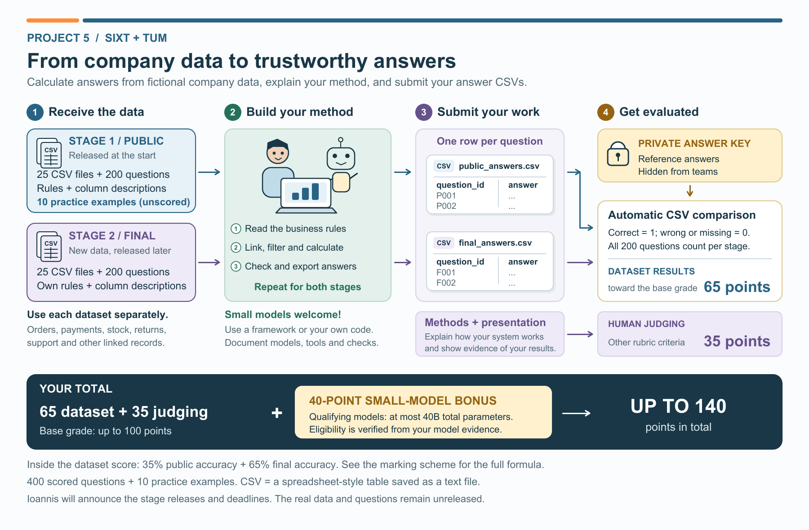
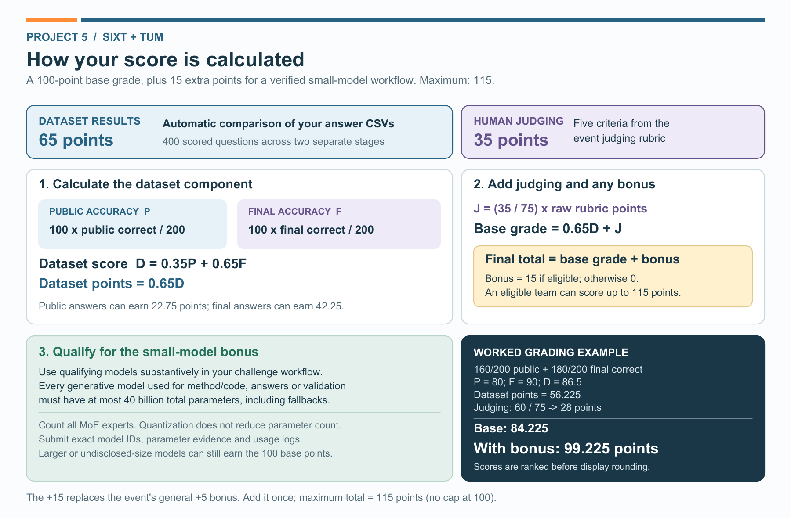

# Project 5: SIXT + TUM

**Stage 2 (final dataset) is available now - 13 November 2026.**

**[Download the Stage 2 student dataset ZIP](releases/problem7_student_final.zip?raw=true)** | [Stage 2 SHA-256 checksum](releases/problem7_student_final.zip.sha256)

Dataset version **7.0.0**: **37 CSV tables and 200 final-stage questions**. The ZIP includes business rules, column descriptions, a blank answer CSV, a format checker and report/model-use templates.

Extract Stage 2 into a **separate folder** and read `README.md`, `EVENT_RULES.md`, `business_rules.md` and `HARD_TASK_RULES.md`. Calculate the answers to `final_questions.csv` using **Stage 2's own `datasets/` folder**, then fill `final_answers.csv` with exactly `question_id,answer`. Submit it as `Project_5/final_answers.csv` through the channel and by the cutoff announced by the organizers. Reusing your method is allowed; the two stages use separate data. The checker tests file format, not answer correctness.

Stage 1 remains available: [download ZIP](releases/problem7_student_start.zip?raw=true) | [checksum](releases/problem7_student_start.zip.sha256). It contains 37 tables, 200 initial questions and 10 unscored practice examples. Stage 2 does not reopen the Stage 1 submission cutoff.

Both student stages are now authorized for release. Preparation-time "local only" or "awaiting authorization" notices inside the unchanged ZIPs are superseded by this announcement.

The base grade is **65 points for dataset answers + 35 points for methods and presentation**. A verified qualifying small-model workflow earns **40 additional points**, for a maximum of **140**. Read `EVENT_RULES.md` for the complete criteria, model-size requirements and report submission process. Coordinate the report's arXiv upload with the organizers.

[Six-slide introductory guide](STUDENT_GUIDE.pdf) | [Three solved toy examples](examples/README.md)

The introductory visuals describe both stages; the release notice above takes precedence over their pre-event release wording.

Contact: **Ioannis Tzachristas** | [Email](mailto:ioannis.tzachristas@tum.de) | [LinkedIn](https://www.linkedin.com/in/ioannis-tzachristas-83a00522a/)
