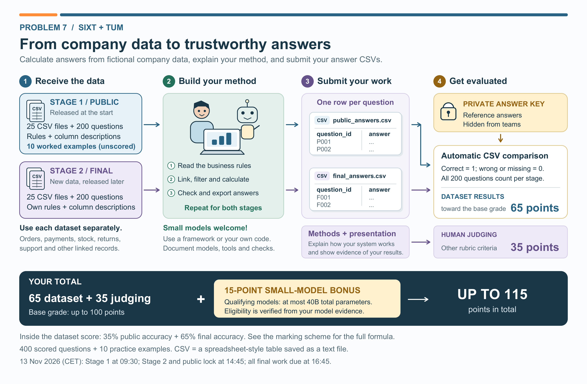
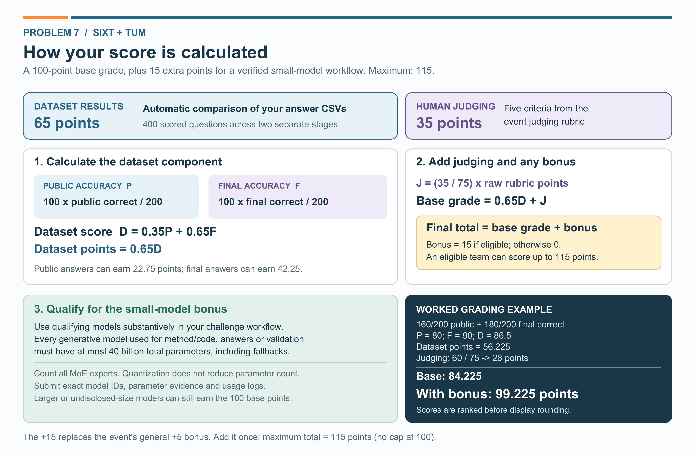

# Problem 7: SIXT + TUM Enterprise Data Agent Challenge

**Project owner:** Ioannis Tzachristas (TUM) · [ioannis.tzachristas@tum.de](mailto:ioannis.tzachristas@tum.de) · [LinkedIn](https://www.linkedin.com/in/ioannis-tzachristas-83a00522a/). On the day, ask on site.

**P7 student guidance is available now.** Competition datasets, answer keys and organizer materials are not included in this repository. Stage data will be provided separately when the organizers authorize release.

**Hackathon:** Friday, 13 November 2026, HQ Pullach, Academy. All times below are local **CET (Europe/Berlin)**. Teams have 1 to 3 people; follow the main repository's topic-selection instructions by 10:00.

**Turn business questions into correct answers. Build a method, calculate the answers from the supplied company data, and submit a CSV.**

[Printable student guide](STUDENT_GUIDE.pdf) · [Toy examples](examples/README.md) · [Method report template](METHOD_REPORT_TEMPLATE.md) · [LaTeX arXiv report template](arxiv_report/README.md)

Companies store information across many systems. A simple question such as “What was net revenue?” can require linking orders, payments and refunds, applying the right business definitions, and converting currencies at the right time. Your team will build an AI-assisted analysis workflow that does this reliably on a fictional company's data.

Small models working with code, SQL, retrieval and other tools are especially welcome. A useful system does not need a huge model: it needs to find the right records, follow the rules and check its calculations.



## What you will do

1. Read the supplied business rules, table descriptions and questions.
2. Use your chosen models and tools to inspect the data, link related records, and calculate an answer for each question.
3. Check the answers and export the required two-column CSV.
4. Explain your architecture, methods, validation and limitations in `SUBMISSION.md` and your demo video or slides.
5. After the Hackathon, coordinate with the organizers and upload your report manuscript to arXiv to finalize your P7 submission.

You may use an existing agent framework, a custom workflow, or a mixture of model calls and ordinary programs. Framework choice alone earns no bonus. There is no requirement to submit a frozen executable solver: the automatically graded deliverable is the answer CSV. Your method and its evidence are assessed separately.

## What teams receive and when

| Release | Contents | What to submit |
|---|---|---|
| Before the Hackathon: 12 Nov | This overview, toy examples, marking policy and method-report template | Prepare your environment and team repository |
| Stage 1: public, 13 Nov at 09:30 | 25 data CSV files, business rules, column descriptions, 200 scored questions, 10 unscored worked examples, blank answer template and optional format checker | `public_answers.csv` before the 14:45 lock |
| Stage 2: final, 13 Nov at 14:45 | A separate snapshot with 25 data CSV files, its rules and column descriptions, 200 scored questions and blank answer template | `final_answers.csv`, code, `SUBMISSION.md`, video or slides and method evidence by 16:45 |
| After the Hackathon: timing agreed with organizers | Report preparation and publication coordination | Required arXiv manuscript upload after coordination, plus upload confirmation and the arXiv link when available |

There are **400 scored questions in total**, plus **10 unscored practice examples**. Every question has one scalar answer: a number, count, date, true/false value, or a text label; some questions request an ordered list in one text cell.

Treat the two snapshots separately. Reuse your workflow where helpful, but calculate each stage's answers from that stage's files and rules. Do not concatenate the snapshots.

The stated stage times are the planned schedule; the organizers must authorize each dataset release separately. At release, they share the appropriate archive and its SHA-256. At 14:45 they record the latest eligible commit in each team's registered repository and lock the public answers. Later edits do not change that locked submission. At 16:45 they record the Hackathon-day final submission. Push your files before each cutoff; keep the repository accessible to the topic owner and organizers. Record the archive filenames, hashes and the code revision used for your calculations in `SUBMISSION.md`; organizers record the locked submission commit IDs separately.

“Public stage” means the first competition stage, not that the repository or answer key is public. Reference answers and answer-level grading details stay private during the event. Any live leaderboard feedback will be announced to all teams on site.

## What makes the task interesting

Expect linked tables covering customers, orders, payments, refunds, products, inventory, procurement, support and contracts. Some records should be excluded; some repeated records are legitimate; some joins can accidentally double-count an amount. Dates, changing contract versions, exchange rates and precise definitions can change the answer.

The challenge is to use models and tools to calculate reliably. Plausible prose is not a substitute for an answer that follows the supplied rules. Python, SQL, spreadsheets and deterministic checks can do the arithmetic while a model plans, selects tools, interprets definitions or checks the workflow.

See [three fully worked toy examples](examples/README.md). These miniature examples are separate from the live competition and can be shared before the event.

## Marking scheme

The base grade is **100 points**. Dataset results contribute **65 points** and the event's other judging criteria contribute **35 points**. An eligible small-model workflow receives **15 additional bonus points**, so the maximum is **115**. The bonus is added once; it is not a multiplier and is not capped at 100.



### Dataset results: up to 65 points

Let `P` and `F` be public and final accuracies as percentages from 0 to 100:

```text
P = 100 × public correct answers / 200
F = 100 × final correct answers / 200
Dataset score D = 0.35 × P + 0.65 × F
Dataset contribution = 0.65 × D
```

The original 35/65 public/final split applies **inside the dataset component**. This makes the public answers worth up to **22.75 points** and final answers worth up to **42.25 points** of the overall grade.

The organizers compare the submitted CSVs with private reference answers. Each correct answer receives 1; a wrong, blank or missing answer receives 0. All 200 questions remain in each stage's denominator. Questions within a stage have equal weight. The format checker only checks file structure; it does not tell you whether an answer is correct.

### Other judging criteria: up to 35 points

Problem 7 retains the five non-results criteria from the event rubric, with their original relative weights. Judges score each criterion on its original scale; the total out of 75 is multiplied by `35 / 75` to produce `J`, the judging contribution out of 35. The original 25-point “Results” category is replaced by the 65-point dataset component, so answer accuracy is not counted twice.

| Criterion | Raw maximum | Contribution to base grade | What judges look for |
|---|---:|---:|---|
| Problem understanding | 15 | 7 | Understanding of the business problem, data and constraints |
| Quality of approach | 25 | 11 2/3 | A sound, justified method, a baseline comparison where available, and awareness of limitations |
| Business relevance and reusability | 15 | 7 | How SIXT could use the approach and clear next steps |
| Code quality and reproducibility | 10 | 4 2/3 | Readable code that runs from the instructions in `SUBMISSION.md`; no secrets or real data |
| Presentation and demo | 10 | 4 2/3 | A clear explanation, working demonstration and good answers |
| **Total** | **75** | **35** | |

```text
J = (35 / 75) × sum of the five raw criterion scores
```

Judge the working method and evidence, not slides alone. For example, raw scores `12 + 20 + 12 + 8 + 8 = 60` earn `J = 28` points. Judges score independently before discussion. The dataset component stays fixed when finalists present; the same five human criteria apply to their pitch and Q&A.

### Small-model bonus: 15 points

The bonus is automatic once the organizers verify all the eligibility conditions below; it is not a subjective award for choosing a fashionable framework. For Problem 7, it replaces the event's general up-to-5-point bonus. The two bonuses do not stack.

- Every generative model used for challenge-specific method design, coding, analysis, answer generation or validation must have **at most 40 billion total parameters**. This includes planners, assistants, validators and fallback models.
- At least one qualifying model must perform a meaningful part of the analysis workflow. Merely reformatting answers already produced by a larger model does not qualify. A wholly manual or model-free solution receives no small-model bonus.
- For mixture-of-experts models, count **all parameters**, including inactive experts, not just the parameters activated per token. Quantization changes precision and memory use, not the parameter count. Each model in a multi-model workflow must meet the limit; their counts are not added together.
- Supply exact model names and versions, publisher/model-card evidence for total parameter counts, the framework and tool configuration, and concise usage/run evidence. Unknown or undisclosed model sizes cannot establish eligibility. A fine-tuned model must still meet the total parameter limit.
- Ordinary Python, SQL, spreadsheet calculations, retrieval and non-generative tools remain allowed. Local and hosted qualifying models are both acceptable, subject to the event's general tool policy.

Using a larger or unverifiable model does not remove your base-grade eligibility; it makes the workflow ineligible for the bonus. Disclose all model use honestly. The bonus has no minimum accuracy threshold and is awarded once for the team's eligible workflow across both stages.

See the [model declaration template](MODEL_DECLARATION.csv) and [method report template](METHOD_REPORT_TEMPLATE.md). Remove credentials and secrets from submitted logs.

### Total grade and example

```text
Base grade = 0.65 × D + J                 (0 to 100)
Bonus = 15 if verified eligible, else 0
Total grade = Base grade + Bonus          (0 to 115)
```

| Example | Result |
|---|---:|
| Public answers correct | 160 / 200 = 80% |
| Final answers correct | 180 / 200 = 90% |
| Dataset score | 0.35 × 80 + 0.65 × 90 = 86.5 |
| Dataset contribution | 0.65 × 86.5 = 56.225 / 65 |
| Other judging points | 28 / 35 |
| Base grade | 84.225 / 100 |
| Verified small-model bonus | +15 |
| Total grade | **99.225 / 115** |

A perfect base grade plus the bonus is **115 points**. Without the bonus, the example team earns **84.225 points**. Keep full precision for ranking; displayed scores may be rounded to two decimals. A displayed `99.22` is a rounded points total, not an accuracy percentage.

Ties on the exact total grade are resolved by higher dataset score, then jury discussion, following the event's Results-first tie policy. Dataset scores and human judging are recorded separately. Problem 7's 115-point maximum is an explicit project-specific exception to the general event rubric; organizers use this published policy for Problem 7 topic reviews and finalist judging.

## Answer CSV format

Use exactly these headers, in this order:

```csv
question_id,answer
DEMO001,1
DEMO002,67.30
DEMO003,0
```

The example IDs above are teaching examples. In the competition, use the IDs supplied in each stage's blank template. Submit `public_answers.csv` for Stage 1 and `final_answers.csv` for Stage 2. Keep one row per question and put only the requested answer in the answer cell. Do not add explanations or extra columns.

| Answer type | Recommended format and scoring rule |
|---|---|
| Number | Follow the question's units and rounding; absolute error at most 0.01 is accepted, with no relative tolerance |
| Count | Exact integral value |
| Date | A valid `YYYY-MM-DD` date |
| Boolean | `true` or `false` |
| Text or ranking | Follow the supplied rule; case and whitespace are normalized, but ranking order matters |
| Undefined answer | `N/A` only when the correct result is undefined under the rules |

An unknown, empty or duplicate ID, incorrect header, or malformed CSV row rejects the file. Missing answer rows and blank answers score zero. CSV row order does not affect accuracy. Use the supplied format checker and resolve errors before the deadline.

## Setup before the event

Install **git and Python 3.11+** and create a virtual environment (`python -m venv .venv` or `uv venv`). Bring your own model access or local models; do not rely on SIXT providing LLM access. If claiming the bonus, your coding assistant must also meet the 40B rule. Create `requirements.txt` or `pyproject.toml` for your method and keep credentials in environment variables or a git-ignored `.env`.

Work inside `Project_7/` in your own team repository, not the organizers' source repository. Use the **Fork** button on [the source repository](https://github.com/sruthi-sixt-26/sixt-hackathon-2026), then clone your fork. Follow the main README to register your repository link and give the organizers access. Before arriving, check that you can run `python --version`, load the toy CSVs and push a commit to your own repository.

- Practise loading and joining CSV tables and exporting `question_id,answer` results.
- Choose your model and check its total parameter count if you plan to claim the bonus.
- Try a small workflow that reads a question, chooses relevant tables, runs a calculation and checks its result.
- Make your environment reproducible: record dependencies, model versions, settings and execution commands.
- Plan how to explain your method, division of work, checks, errors and limitations clearly.

Use [METHOD_REPORT_TEMPLATE.md](METHOD_REPORT_TEMPLATE.md) to prepare `SUBMISSION.md`. Cite the dataset using the citation supplied with the stage package, along with the package version, archive hash and access date. Only include a DOI if one has actually been assigned.

## Submission checklist

- Valid `public_answers.csv` before the Stage 1 lock.
- Valid `final_answers.csv` before the final deadline.
- `Project_7/SUBMISSION.md`, using the method-report template.
- Your method code, dependencies/configuration and concise run evidence, with fresh-clone instructions sufficient to reproduce the workflow.
- **Either** `Project_7/submission/demo.mp4` (1-minute demo video, under 50 MB) **or** `Project_7/submission/slides.pdf` (at most 5 slides).
- Completed model declaration, including coding assistants and fallbacks; bonus evidence if claiming the small-model bonus.
- Dataset citation and any external code/model acknowledgements.
- After organizer coordination: the required report manuscript upload to arXiv, with confirmation supplied to the organizers, as explained below.

The registered team repository is the Hackathon-day submission. Keep the answer files at `Project_7/public_answers.csv` and `Project_7/final_answers.csv`. By 16:45, push all Hackathon-day deliverables; no hacking is allowed during the 16:45-17:45 review period. Six finalists are selected across topics. If selected, give a maximum 3-minute pitch plus 2 minutes of Q&A during 17:45-18:20. Teams choosing a backup topic must name a primary topic and are scored under that primary topic's rubric.

## Required report and coordinated arXiv upload

**This requirement applies to Problem 7.** Submit your method report as `Project_7/SUBMISSION.md` by **16:45 CET on 13 November 2026**, together with the other Hackathon-day deliverables.

To finalize your P7 submission, your team must also prepare the report as an arXiv manuscript and upload it **after coordinating with the organizers**. Agree the upload timing, author list, dataset citation and manuscript content with the organizers before uploading. The later upload date will be confirmed during that coordination; it is not the 16:45 Hackathon deadline.

Use the [simple LaTeX report template](arxiv_report/README.md), which includes the dataset citation, model-use declaration and instructions for compiling and preparing a report-only source archive.

Send the upload confirmation and, when available, the arXiv identifier or link to the organizers. Record them in the publication follow-up section of your report. This later step does not replace the report due at 16:45 or reopen the locked answer CSVs and event results.

The report upload does **not** authorize publication of the challenge datasets, golden answers, private evaluation details or organizer material. Keep these out of the manuscript, source files and attachments. Use the supplied public toy examples where illustrations are needed. Coordinate any publication or submission difficulty with the organizers.

Follow the event's data and integrity rules: use supplied synthetic/public data, never commit real SIXT/customer/personal data or secrets, and do not share the source repository outside the Hackathon. If a late or inaccessible repository prevents verification, the unverifiable dataset or code/reproducibility component receives no points under the event's late policy. Other misconduct follows the event's published disqualification rules.

Problem 7 uses the scoring policy on this page, including its replacement bonus. Older dataset documentation describing 35% public + 65% final as the “official score” refers to `D`, the dataset score only; it is not the full Hackathon grade.
